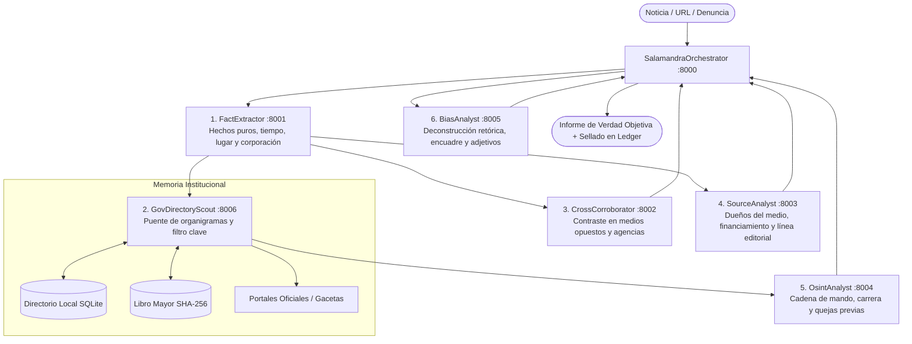

<div align="center">

  

  # 🦎 SALAMANDRA
  
  **Sistema Multi-Agente A2A para Deconstrucción de Sesgo Noticioso, Trazabilidad Forense Institucional y Memoria Inmutable**

  [](https://cloud.google.com/vertex-ai)
  [](https://google.github.io/adk-docs/)
  [-00ACC1?style=for-the-badge)](https://google.github.io/adk-docs/)
  [](https://python.org)
  [](LICENSE)
  []()

  <p align="center">
    <em>Salamandra audita notas periodísticas, deconstruye marcos narrativos tendenciosos, contrasta fuentes opuestas en tiempo real, desclasifica la cadena de mando institucional y registra los hallazgos en un libro mayor criptográficamente sellado.</em>
  </p>

</div>

---

## 📑 Tabla de Contenidos

- [Visión y Principios](#-visión-y-principios)
- [Arquitectura de la Red A2A (7 Microservicios)](#-arquitectura-de-la-red-a2a-7-microservicios)
- [Módulos de la Interfaz Web](#-módulos-de-la-interfaz-web)
- [Pila Tecnológica](#-pila-tecnológica)
- [Guía de Inicio Rápido (Local)](#-guía-de-inicio-rápido-local)
- [Despliegue en Google Cloud (Vertex AI & Cloud Run)](#-despliegue-en-google-cloud-vertex-ai--cloud-run)
- [Estructura del Proyecto](#-estructura-del-proyecto)
- [Batería de Pruebas Automatizadas](#-batería-de-pruebas-automatizadas)
- [Garantía Criptográfica e Integridad](#-garantía-criptográfica-e-integridad)

---

## 🎯 Visión y Principios

En la cobertura de operativos policiales, actuaciones ministeriales y resoluciones judiciales, los medios de comunicación suelen incorporar **sesgos de encuadre (*framing*), omisiones deliberadas o adjetivación criminalizante**. Al mismo tiempo, las notas raramente individualizan a los mandos operativos responsables, diluyendo la rendición de cuentas pública.

**Salamandra** nace para resolver este problema mediante tres pilares fundamentales:

1. **Veredicto Centrado en los Hechos, no en la Retórica del Medio**: El análisis evalúa la veracidad material y objetiva de los acontecimientos investigados, desmantelando la opinión editorial y contrastando versiones antagónicas.
2. **Puente Institucional y Trazabilidad Nominal**: Conecta hechos noticiosos con dependencias gubernamentales mediante el mapeo de organigramas oficiales, jerarquías de mando, períodos de gestión y antecedentes documentados de quejas por violaciones a derechos humanos.
3. **Inmutabilidad y Transparencia Criptográfica**: Cada investigación, funcionario registrado y queja de abuso de autoridad queda sellada con un bloque hash **SHA-256 encadenado**, garantizando que la memoria histórica no sea alterada ni purgada retroactivamente.

---

## ⚡ Arquitectura de la Red A2A (7 Microservicios)

Salamandra opera como un ecosistema autónomo de microservicios coordinados mediante el protocolo oficial **A2A (Agent-to-Agent)** de Google ADK sobre JSON-RPC y HTTP:



### Funciones de los Agentes:

| # | Agente | Puerto | Nivel / Modelo | Responsabilidad Principal |
| :-: | :--- | :-: | :--- | :--- |
| **1** | `FactExtractor` | `8001` | *Light* (`gemini-2.5-flash`) | Extrae los hechos verificables: fecha, hora, ubicación, corporación participante y saldo de personas afectadas. |
| **2** | `GovDirectoryScout` | `8006` | *Balanced* (`gemini-2.5-flash`) | Consulta la caché local o rastrea organigramas oficiales; descarta perfiles administrativos y selecciona los mandos operativos clave. |
| **3** | `CrossCorroborator` | `8002` | *Balanced* (`gemini-2.5-flash`) | Busca y contrasta versiones alternativas en agencias de noticias neutras y publicaciones de línea editorial opuesta. |
| **4** | `SourceAnalyst` | `8003` | *Balanced* (`gemini-2.5-flash`) | Audita el medio emisor: estructura accionaria, contratos de publicidad oficial documentados e historial de credibilidad. |
| **5** | `OsintAnalyst` | `8004` | *Deep* (`gemini-2.5-flash`) | Investiga a fondo a los mandos identificados: superiores inmediatos, promociones de rango y quejas formales de abuso de poder. |
| **6** | `BiasAnalyst` | `8005` | *Deep* (`gemini-2.5-flash`) | Desarticula la narrativa: identifica sesgo de encuadre, voz pasiva para ocultar responsabilidad policial y omisión de testimonios. |
| **7** | `SalamandraOrchestrator` | `8000` | *Deep* (`gemini-2.5-flash`) | Coordina el pipeline A2A, redacta la síntesis objetiva definitiva y persiste la auditoría en el libro mayor. |

---

## 🖥️ Módulos de la Interfaz Web

La interfaz web incorpora un diseño estético contemporáneo (*glassmorphism*, modo oscuro de alta legibilidad, paleta HSL curada) y un menú de navegación intuitivo (`#app-navbar`) con estado persistente:

### 1. 🔍 Nueva Consulta (`#nueva-consulta`)
- Formulario de entrada limpio para URL de notas de prensa o texto descriptivo de un evento o cateo.
- **Monitor de Pipeline en Vivo**: Visualización interactiva con el estado de avance de los 7 microservicios A2A.

### 2. 📋 Historial de Reportes (`#historial`)
- **Filtros Rápidos de Fecha**: Píldoras de un solo clic (`Todos`, `Hoy`, `Últimos 7 días`, `Últimos 30 días`) y selectores de calendario `Desde` / `Hasta`.
- **Buscador Dinámico**: Filtrado en tiempo real por palabras clave o medios.
- **Tabla Ejecutiva**:
  - Título del artículo con enlace a la fuente original.
  - Insignia con el dominio de la web de procedencia (`elpais.com`, `jornada.com.mx`, etc.).
  - Fecha y hora formateada.
  - Píldoras de funcionarios implicados con acceso al **Expediente Forense**.
  - Acciones directas para ver el informe o copiar el ID de auditoría.

### 3. 🏛️ Directorio de Entidades y Operadores (`#directorio`)
- **Filtros Multi-Criterio**:
  - **🗺️ Entidad Federativa**: Desplegable dinámico (*Jalisco*, *Ciudad de México*, *Federal*, *Nuevo León*, etc.).
  - **🏢 Institución**: Desplegable con dependencias evaluadas (*Fiscalía General*, *Secretaría de Seguridad*, *Tribunal*).
  - **🚨 Status de Reportes**: *Con reportes de abuso documentados*, *Sin antecedentes validados*, *En investigación / Impune*.
  - **Filtro de Sector**: *Policial*, *Fiscalía*, *Judicial*, *Administrativo*.
- **Alternador de Vistas**:
  - **🗂️ Vista de Tarjetas**: Detalle de período en el cargo, formación académica, sede oficial, cadena de mando y botón de expediente.
  - **📑 Vista de Tabla Ejecutiva**: Formato condensado de alta densidad de datos.
- **Modal de Expediente Forense Completo**:
  - Consulta detallada de datos curriculares de transparencia.
  - Historial pormenorizado de quejas de violaciones a derechos humanos con fuentes contrastadas.
  - Botón para exportar el dossier completo en formato Markdown.

### 4. 📄 Informe Detallado (`#informe`)
- Presentación del informe de verdad objetiva con formato tipográfico optimizado.
- Botón **"← Volver al Historial"** y acción de copiado rápido al portapapeles.

### 5. ⛓️ Libro Mayor Inmutable (`#ledger`)
- Explorador de bloques SHA-256 con validador de integridad criptográfica en tiempo real.

---

## 🛠️ Pila Tecnológica

- **Framework de Agentes**: [Google Agent Development Kit (ADK)](https://google.github.io/adk-docs/)
- **Protocolo de Comunicación**: Agent-to-Agent (A2A) sobre HTTP / JSON-RPC
- **Modelos Fundacionales**: Google Vertex AI (`gemini-2.5-flash`, con fallback de cuotas y reintentos exponenciales con jitter)
- **Backend & Servidor Web**: Starlette + Uvicorn (ASGI)
- **Persistencia**: SQLite3 con migraciones automáticas (`data/salamandra_directory.db`)
- **Criptografía**: SHA-256 Ledger inmutable (`data/audit_ledger.jsonl`)
- **Frontend**: HTML5 Semántico, Vanilla CSS (tokens HSL, Glassmorphism, Google Fonts Outfit & Inter), Vanilla JavaScript modular sin dependencias externas
- **Pruebas**: Pytest + pytest-asyncio (17/17 pruebas automatizadas)
- **Infraestructura Cloud**: Google Cloud Run, Artifact Registry y Terraform

---

## 🚀 Guía de Inicio Rápido (Local)

### Requisitos Previos:
- Python 3.12+
- Google Cloud SDK (`gcloud`) configurado con Application Default Credentials:
  ```bash
  gcloud auth application-default login
  ```

### 1. Clonar el Repositorio
```bash
git clone https://github.com/Freakisimo/salamandra.git
cd salamandra
```

### 2. Configurar Variables de Entorno
Copia la plantilla y configura tu proyecto de Google Cloud:
```bash
cp .env.template .env
```
Edita `.env` con tu Project ID de GCP:
```ini
GOOGLE_CLOUD_PROJECT=tu-proyecto-gcp
GOOGLE_CLOUD_LOCATION=us-central1
DEFAULT_LIGHT_MODEL=gemini-2.5-flash
DEFAULT_BALANCED_MODEL=gemini-2.5-flash
DEFAULT_DEEP_MODEL=gemini-2.5-flash
```

### 3. Levantar Salamandra con el Script Unificado
El script `run_local.sh` crea el entorno virtual, instala dependencias e inicia todos los microservicios en segundo plano:
```bash
chmod +x run_local.sh
./run_local.sh
```

Una vez levantado, ingresa a tu navegador en:
👉 **[http://localhost:8000](http://localhost:8000)**

---

## ☁️ Despliegue en Google Cloud (Vertex AI & Cloud Run)

Para desplegar la flota completa de microservicios en Cloud Run:

```bash
chmod +x deploy.sh
./deploy.sh
```

El script automatiza:
1. Habilitación de APIs en GCP (`aiplatform.googleapis.com`, `run.googleapis.com`, `artifactregistry.googleapis.com`).
2. Creación del repositorio en Artifact Registry.
3. Construcción y publicación de la imagen de contenedor.
4. Despliegue de los servicios en Cloud Run con autenticación y variables de entorno configuradas.

Para gestionar la infraestructura como código mediante Terraform:
```bash
cd terraform/
terraform init
terraform plan
terraform apply
```

---

## 📂 Estructura del Proyecto

```
salamandra/
├── assets/
│   └── salamandra_logo.png           # Logotipo oficial de Salamandra
├── data/
│   ├── salamandra_directory.db       # Base de datos SQLite (operadores, noticias, incidentes)
│   └── audit_ledger.jsonl            # Libro mayor inmutable SHA-256
├── src/
│   ├── agents/
│   │   ├── fact_extractor.py         # Microservicio 1: Extractor de hechos (8001)
│   │   ├── gov_directory_scout.py    # Microservicio 2: Puente institucional y organigramas (8006)
│   │   ├── cross_corroborator.py     # Microservicio 3: Contraste multi-fuente (8002)
│   │   ├── source_analyst.py         # Microservicio 4: Auditoría de medios y dueños (8003)
│   │   ├── osint_analyst.py          # Microservicio 5: OSINT y cadena de mando (8004)
│   │   ├── bias_analyst.py           # Microservicio 6: Deconstrucción de sesgo (8005)
│   │   └── orchestrator.py           # Microservicio 7: Orquestador maestro y servidor web (8000)
│   ├── config/
│   │   ├── models.py                 # Resolutor de modelos, tiers y RetryConfig con jitter
│   │   └── settings.py               # Configuración centralizada de entorno
│   ├── core/
│   │   ├── a2a_client.py             # Cliente de invocación del protocolo A2A
│   │   └── registry.py               # Registro de microservicios y puertos
│   ├── storage/
│   │   ├── schema.sql                # Esquema DDL relacional con índices optimizados
│   │   ├── person_directory.py       # Gestor del directorio de entidades y migraciones
│   │   └── ledger.py                 # Implementación del libro mayor criptográfico
│   ├── tools/
│   │   ├── osint_tools.py            # Herramientas de consulta a directorio y organigramas
│   │   └── web_scraper.py            # Extractor de contenido web y articulado
│   └── web/
│       ├── static/
│       │   ├── css/styles.css        # Sistema de diseño, navbar, tarjetas y tablas
│       │   ├── img/salamandra_logo.png
│       │   └── js/app.js             # Lógica SPA, ruteo por hash, filtros y pipeline tracker
│       └── templates/
│           └── index.html            # Plantilla base con las 5 vistas estructuradas
├── tests/
│   ├── test_gov_scout.py             # Pruebas del puente institucional
│   ├── test_models.py                # Pruebas de fallbacks y modelos
│   ├── test_smoke.py                 # Pruebas de instanciación de agentes A2A
│   ├── test_storage.py               # Pruebas de SQLite, filtros de fecha y jurisdicción
│   ├── test_tools.py                 # Pruebas de scraping y OSINT
│   └── test_web.py                   # Pruebas de endpoints web, filtros y UI
├── Dockerfile                        # Imagen de contenedor para Cloud Run
├── deploy.sh                         # Script de despliegue en Google Cloud
├── run_local.sh                      # Lanzador unificado de entorno local
├── run_salamandra.py                 # Runner multiproceso de los agentes
└── requirements.txt                  # Dependencias de Python
```

---

## 🧪 Batería de Pruebas Automatizadas

El proyecto cuenta con cobertura exhaustiva de pruebas unitarias y de integración que validan desde la persistencia relacional hasta el protocolo de comunicación A2A:

```bash
./venv/bin/pytest -v tests/
```

Salida esperada:
```text
============================== test session starts ==============================
collected 17 items

tests/test_gov_scout.py::test_institution_cache_and_persistence PASSED     [  5%]
tests/test_gov_scout.py::test_search_gov_organigram_interface PASSED       [ 11%]
tests/test_gov_scout.py::test_gov_scout_agent_properties PASSED            [ 17%]
tests/test_models.py::test_model_resolver_default_tiers PASSED             [ 23%]
tests/test_models.py::test_model_resolver_dynamic_fallback PASSED          [ 29%]
tests/test_smoke.py::test_agents_instantiation_and_a2a_apps PASSED         [ 35%]
tests/test_storage.py::test_ledger_append_and_verify PASSED                [ 41%]
tests/test_storage.py::test_ledger_tamper_detection PASSED                 [ 47%]
tests/test_storage.py::test_person_directory_crud_and_dossier PASSED       [ 52%]
tests/test_storage.py::test_investigation_persistence_and_retrieval PASSED [ 58%]
tests/test_storage.py::test_operator_incident_counts_and_search_filters PASSED [ 64%]
tests/test_storage.py::test_jurisdiction_and_directory_filter_options PASSED [ 70%]
tests/test_storage.py::test_investigation_date_filtering_and_domain_extraction PASSED [ 76%]
tests/test_tools.py::test_scraper_invalid_url PASSED                       [ 82%]
tests/test_tools.py::test_osint_local_directory_flow PASSED                [ 88%]
tests/test_web.py::test_web_ui_endpoints PASSED                            [ 94%]
tests/test_web.py::test_extract_text_from_a2a_response_formats PASSED      [100%]

============================== 17 passed in 10.41s ==============================
```

---

## 🔒 Garantía Criptográfica e Integridad

Cada acción en Salamandra (registro de investigaciones, desclasificación de mandos u homologación de quejas) genera una entrada inmutable con la siguiente estructura:

$$\text{Hash}_n = \text{SHA-256}\big(n \mathbin{\Vert} \text{timestamp} \mathbin{\Vert} \text{acción} \mathbin{\Vert} \text{payload} \mathbin{\Vert} \text{Hash}_{n-1}\big)$$

Si cualquier registro en el disco sufriera alteración o manipulación maliciosa, el verificador de integridad (`GET /api/ledger`) detectará inmediatamente la ruptura en la cadena hash, alertando en la interfaz visual con un estado de discrepancia.

---

<div align="center">
  <b>Salamandra • Por la Verdad Fáctica, la Desclasificación de Mandos y la Transparencia</b><br/>
  Construido con Google Agent Development Kit (ADK) y Vertex AI.
</div>
